<!-- ═══════════════════ HEADER ═══════════════════ -->

  

  

  
  
  
  

  <a href="#about"><b>About</b></a> &nbsp;•&nbsp;
  <a href="#projects"><b>Projects</b></a> &nbsp;•&nbsp;
  <a href="#stack"><b>Stack</b></a> &nbsp;•&nbsp;
  <a href="#stats"><b>Stats</b></a> &nbsp;•&nbsp;
  <a href="#contact"><b>Contact</b></a>

<!-- ═══════════════════ AT A GLANCE ═══════════════════ -->

  
  
  
  

<!-- ═══════════════════ ABOUT ═══════════════════ -->
<h2 align="center" id="about">About Me</h2>

  
  

<!-- ═══════════════════ PROJECTS ═══════════════════ -->
<h2 align="center" id="projects">Projects</h2>

<h3 align="center">🔨 Currently Building</h3>

  <a href="https://github.com/Jivaansh-Yadav/lambda-prep-test"></a>

<h3 align="center">✅ Shipped</h3>

  <a href="https://github.com/Jivaansh-Yadav/KrishiLink"></a>
  <a href="https://github.com/Aman-Gautam67/Flow-Intel"></a>

  <a href="https://github.com/Jivaansh-Yadav/pookoo-run"></a>
  <a href="https://github.com/Jivaansh-Yadav/icse-resources"></a>

  <a href="https://github.com/Jivaansh-Yadav/MeteoNerd"></a>
  <a href="https://github.com/Jivaansh-Yadav?tab=repositories"></a>

<!-- ═══════════════════ STACK ═══════════════════ -->
<h2 align="center" id="stack">Tech Stack</h2>

   
  

   
  

   
  

   
  

   
  

<!-- ═══════════════════ STATS ═══════════════════ -->
<h2 align="center" id="stats">GitHub Dashboard</h2>

  
  

  

  

  
<b>🏆 Trophies</b>

   
  

    
  

  
<b>⏳ Activity over time</b>

   
  

    
  

<!-- ═══════════════════ CONTACT ═══════════════════ -->
<h2 align="center" id="contact">Let's Connect</h2>

  Got a weird idea, a collab, or a project worth prototyping? Say hi.

  
  

  

  

