<!-- ═══════════════════ HEADER ═══════════════════ -->

  

  

  
  
  
  

<!-- nav -->

  
  
  
  
  

<!-- ═══════════════════ AT A GLANCE ═══════════════════ -->

  
  
  
  

<!-- ═══════════════════ ABOUT ═══════════════════ -->
<h2 align="center" id="about"></h2>

  
  

  

<!-- ═══════════════════ PROJECTS ═══════════════════ -->
<h2 align="center" id="projects"></h2>

<h3 align="center">🔨 Currently Building</h3>

  

<h3 align="center">✅ Shipped</h3>

  
  

  
  

  
  

<!-- ═══════════════════ STACK ═══════════════════ -->
<h2 align="center" id="stack"></h2>

   
  

   
  

   
  

   
  

   
  

<!-- ═══════════════════ STATS ═══════════════════ -->
<h2 align="center" id="stats"></h2>

  
   
  
  

  

<h3 align="center">🏆 Trophies</h3>
   
  

    
  

<h3 align="center">⏳ Activity over time</h3>
   
  

    
  

<!-- ═══════════════════ CONTACT ═══════════════════ -->
<h2 align="center" id="contact"></h2>

  

  
  

  

  

